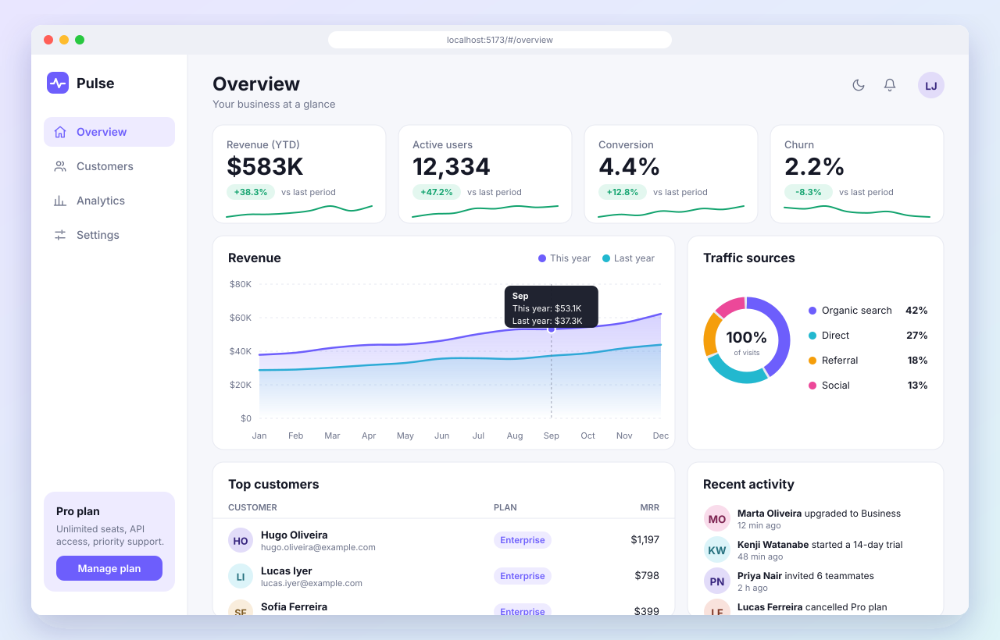

<p align="center">
  
</p>
<p align="center"><sub>Preview: design illustration of the Overview screen (light theme).</sub></p>

# Pulse: React SaaS Admin Dashboard

A modern, free admin dashboard template built with **React 18**, **TypeScript** and **Vite**. No UI library, no chart library, no router dependency: just React and a small, readable codebase you can copy into your own product.

## Features

- **Overview**: KPI cards with sparklines, revenue area chart with hover tooltip, traffic donut, top customers and activity feed
- **Customers**: search, status filter, sortable columns, pagination and **CSV export**
- **Analytics**: 3M / 6M / 12M range switch, active users chart, sign-up bars and a conversion funnel
- **Settings**: validated profile form, toggle switches and dark mode
- **Light and dark themes**, remembered between visits, no flash on load
- **Responsive**: sidebar becomes an off-canvas menu on small screens
- **Accessible**: semantic markup, keyboard focus styles, `aria-sort`, `aria-pressed`, labelled controls
- **Zero dependencies** beyond React: hand-written SVG charts and a tiny hash router

## Quick start

```bash
git clone https://github.com/lenivalestevao/react-saas-dashboard.git
cd react-saas-dashboard
npm install
npm run dev
```

Other scripts:

| Command | What it does |
| --- | --- |
| `npm run build` | Type-check and create a production build in `dist/` |
| `npm run preview` | Serve the production build locally |
| `npm test` | Run the unit tests (Vitest) |
| `npm run typecheck` | TypeScript check only |

## Project structure

```
src/
  App.tsx                 Shell: sidebar, topbar and page switch
  styles.css              Design tokens (light and dark) and all styles
  components/
    charts.tsx            AreaChart, BarChart, Donut, Sparkline (pure SVG)
    DataTable.tsx         Generic sortable, paginated table
    StatCard.tsx, Sidebar.tsx, Topbar.tsx, ui.tsx
  pages/                  Overview, Customers, Analytics, Settings
  lib/
    router.ts             Hash router hook (works on any static host)
    theme.ts              Theme hook with persistence
    geometry.ts           Smooth curves and axis maths
    table.ts              Sorting, pagination, CSV
    format.ts             Money, numbers, dates
  data/mock.ts            Deterministic demo data (seeded)
```

## Make it yours

- **Brand color**: change `--accent` (and `--c1` to `--c4`) in `src/styles.css`
- **Real data**: replace the exports in `src/data/mock.ts` with calls to your API
- **New page**: add its name to `ROUTES` in `src/lib/router.ts`, create a file in `src/pages/` and render it in `App.tsx`
- **New table**: describe your columns with `Column<T>` and pass rows to `<DataTable />`

## Notes

The preview above is a design illustration. The demo data is generated from a fixed seed, so the numbers are the same on every load and are not real.

## License

MIT, free for personal and commercial use. See [LICENSE](LICENSE).
